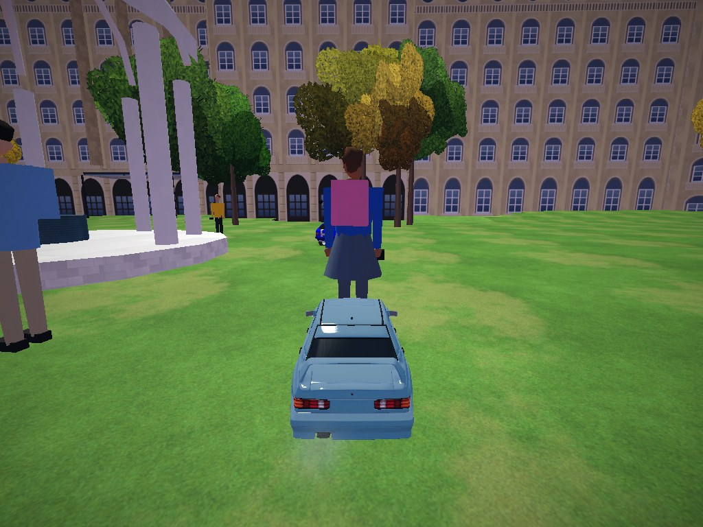

# Gellért-hegy - Citadella

A [SuperTuxKart](https://supertuxkart.net) add-on track on Gellért Hill in Budapest. The lap starts on Szent Gellért tér in front of the Hotel Gellért, climbs Verejték utca and the stairs up to Citadella sétány, goes round the Citadella past the Liberty Statue, and comes back down Szabó Dezső sétány and Verejték utca to the hotel. On the way down a shortcut turns off to the right through the tube slide of the hillside playground.



## Install

Clone it into your SuperTuxKart add-on tracks folder:

```bash
cd ~/.local/share/supertuxkart/addons/tracks
git clone https://github.com/AronNovak/stk-track-gellert-hegy.git
```

The tracks folder is `%APPDATA%\supertuxkart\addons\tracks` on Windows and `~/Library/Application Support/SuperTuxKart/addons/tracks` on macOS. Without git, download the ZIP and extract it there.

The track shows up under the Add-Ons group. Tested with SuperTuxKart 1.5.

## License

Copyright © 2026 Áron Novák. Licensed under [CC BY-SA 4.0](license.txt).

Streets and building footprints are derived from map data © [OpenStreetMap](https://www.openstreetmap.org/copyright) contributors, available under the ODbL. Terrain heights are produced using Copernicus data and information funded by the European Union (EU-DEM).

The music and sky box come from the SuperTuxKart base game and are not part of this repository. Signs only show the names of real places and are not endorsed by their owners.
